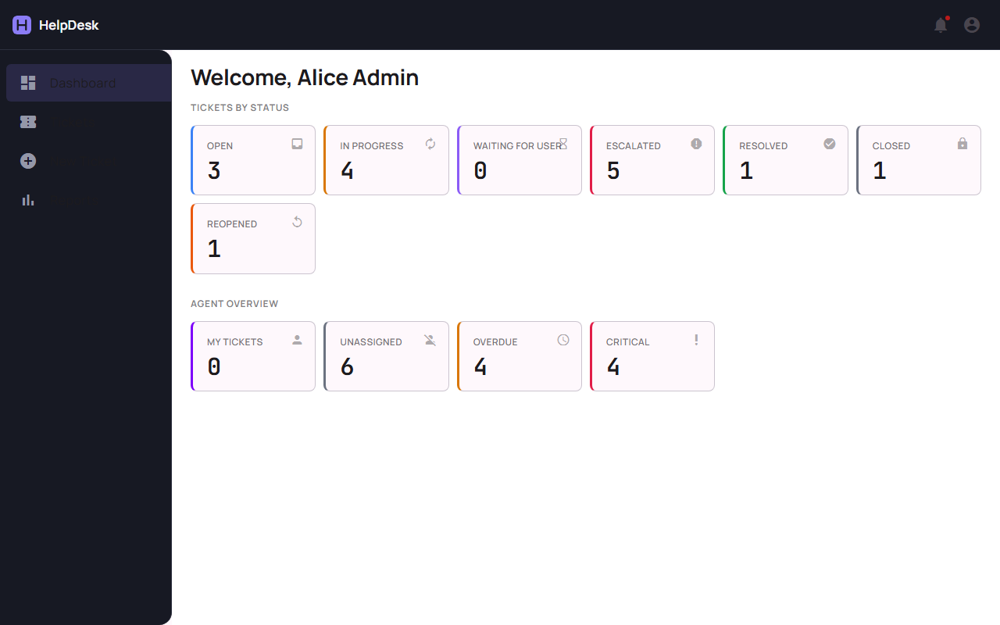
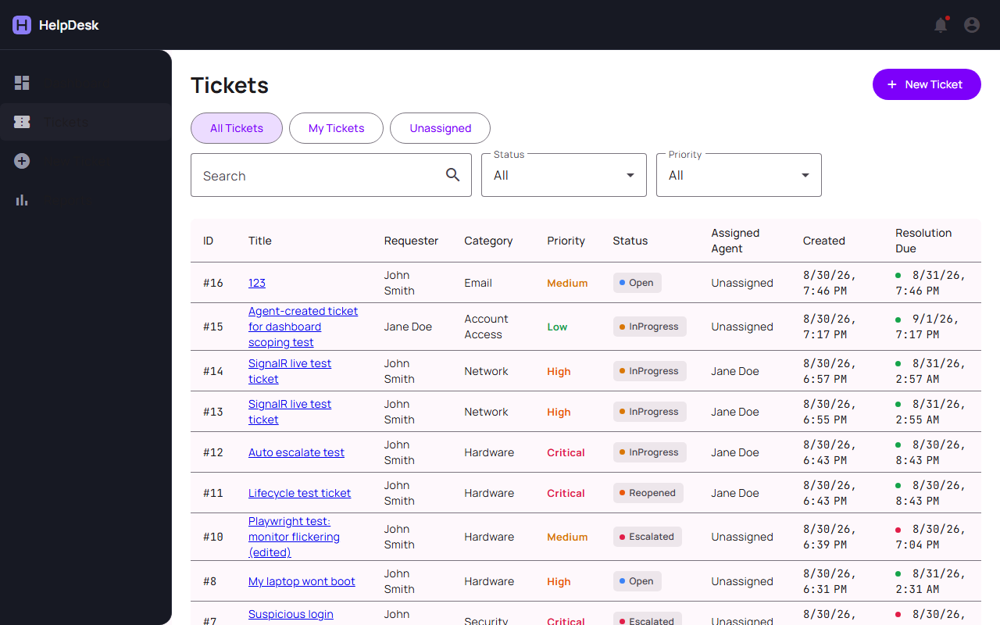
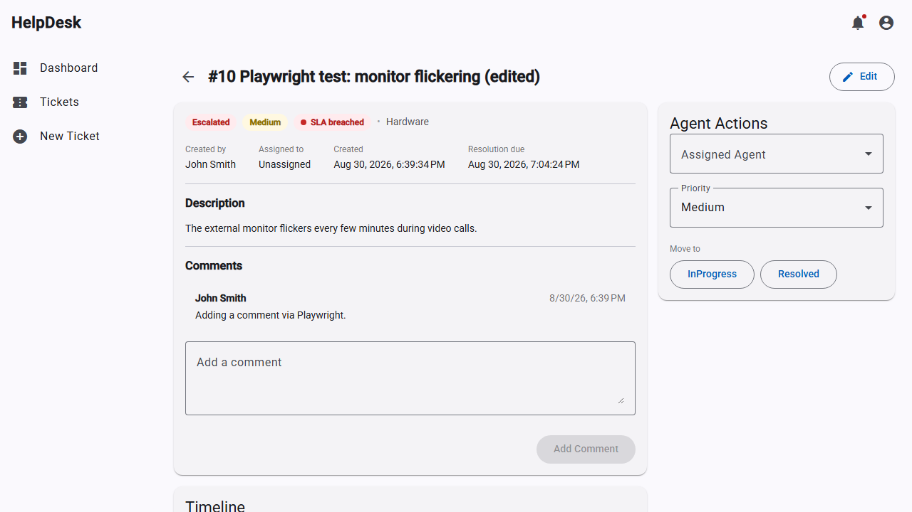
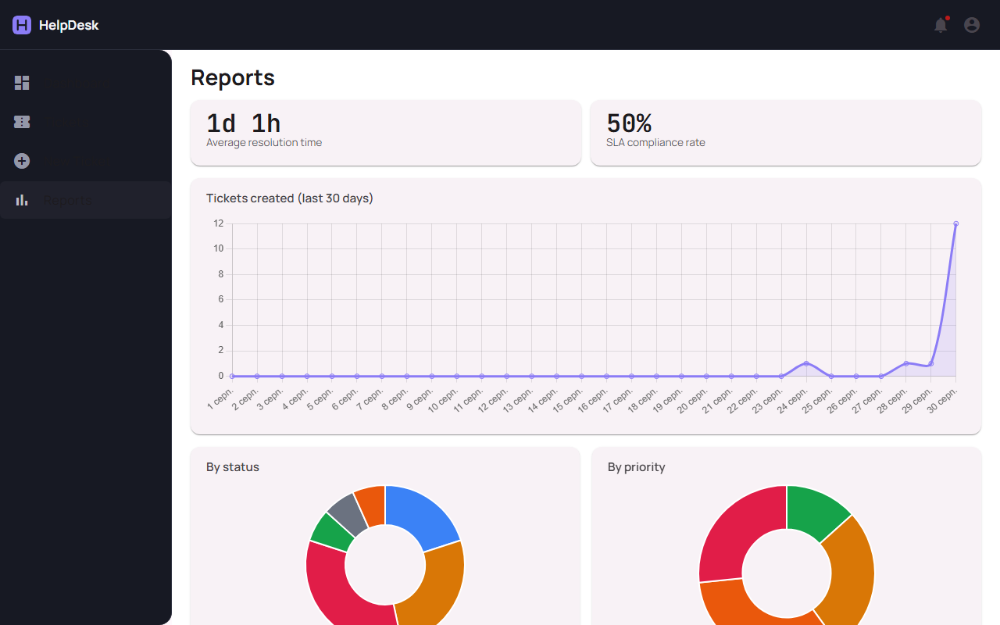

# HelpDesk

IT support ticket system. Employees create tickets, agents work on them, and admins manage settings and see reports.

Built with ASP.NET Core 10, Angular 22, and PostgreSQL.



## Features

- Three roles: **Employee**, **Agent**, **Admin**. Each role sees its own dashboard and only the tickets it is allowed to see.
- Tickets with category, priority, department, comments, and a history of every change.
- Status changes follow fixed rules (for example, a closed ticket can't jump back to "In progress"). The backend checks them, not only the UI.
- Live notifications with SignalR: agents get a pop-up when a new ticket arrives, and users see updates on their tickets without refreshing.
- SLA timers per priority. A background service checks open tickets every minute, warns the agent before the deadline, and escalates the ticket automatically when it is missed.
- Ticket list with search, filters, sorting, and paging done on the server.
- Admin reports: tickets over the last 30 days, by category, priority, and agent, average resolution time, and SLA compliance.

## Tech stack

- **Backend:** ASP.NET Core 10 Web API, EF Core 10, PostgreSQL 17, FluentValidation, SignalR
- **Frontend:** Angular 22 (standalone components), Angular Material, Chart.js
- **Auth:** JWT access tokens + refresh tokens that rotate on every use, BCrypt passwords
- **Tests:** xUnit + Moq (backend), Vitest (frontend)
- **Run:** Docker Compose (database, API, frontend on nginx)

## How it's organized

Controllers only handle HTTP. Business rules live in services (`TicketService`, `AuthService`), and the ticket status rules are in one place (`TicketLifecycle`). Errors are turned into proper HTTP codes by one middleware.

On the frontend, an interceptor adds the token to requests and, if a request gets 401, refreshes the token and retries once.

Migrations in `Data/Migrations` are written by hand because `dotnet ef` tools were blocked on my machine by Windows Smart App Control.

## Run it

With Docker:

```bash
cp .env.example .env   # set JWT_SECRET (at least 32 characters)
docker compose up --build
```

- App: http://localhost:4200
- API: http://localhost:8080
- Swagger: http://localhost:8080/swagger

The database and demo data are created on first start.

Without Docker, you need the .NET 10 SDK, Node.js 24+ and a local PostgreSQL:

```bash
cd backend/HelpDesk.Api
dotnet user-secrets set "Jwt:Secret" "<random string, 32+ chars>"
dotnet run

cd frontend/helpdesk-ui
npm install
npm start
```

## Demo accounts

Password for all: `Password123!`

| Email | Role |
|---|---|
| admin@example.com | Admin |
| agent1@example.com | Agent |
| agent2@example.com | Agent |
| employee@example.com | Employee |

## Tests

```bash
cd backend/HelpDesk.Api.Tests && dotnet test
cd frontend/helpdesk-ui && npm test
```

Backend tests cover the status rules, SLA calculation, and ticket permissions. Frontend tests cover guards, the token refresh flow and forms.

## Screenshots

| Ticket list | Ticket detail |
|---|---|
|  |  |



## What's next

- File attachments (the data model exists; the upload endpoint doesn't yet)
- User management for admins
- Normal generated migrations once the tooling works
